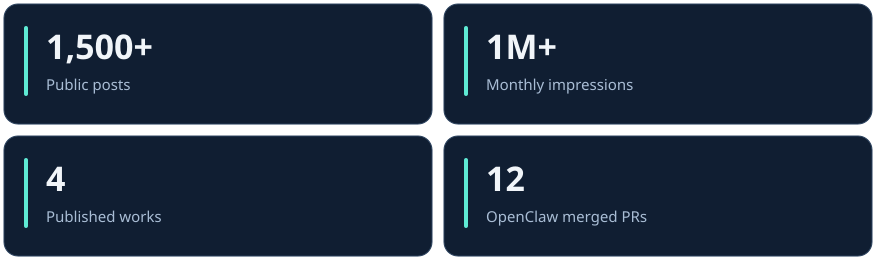
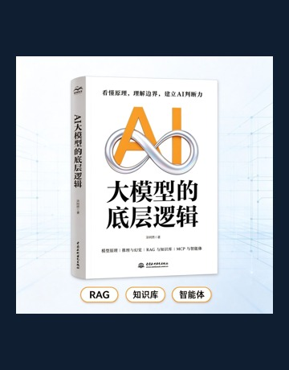
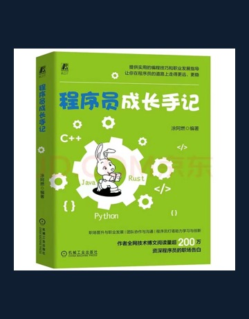
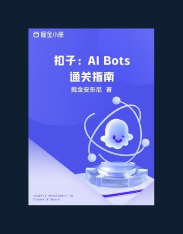
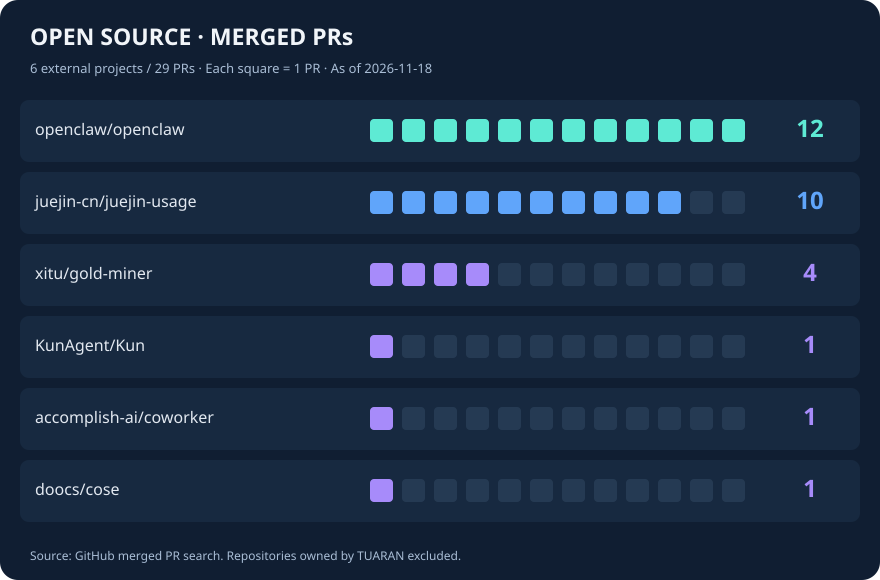
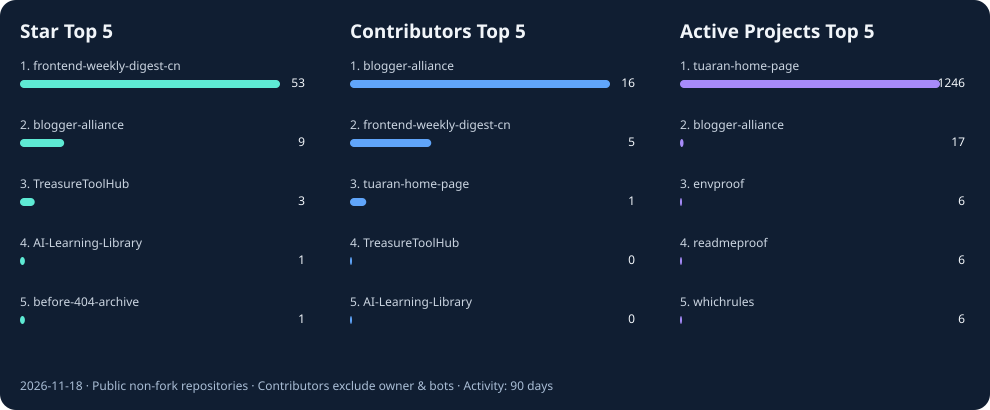

**English** · [中文](README.zh-CN.md)

# TUARAN

AI deployment engineer, technical writer, and founder of [MatrixLink](https://matrixlink.tech). I work on AI agents, model tool protocols, and context engineering, then bring those capabilities into real products—from prototypes and deployment to authentication, testing, and maintenance.

[Website](https://2aran.com) · [About](https://2aran.com/about) · [Publications](https://2aran.com/publications) · [Email](mailto:tuaran666@gmail.com)

## At a Glance

Text version · self-reported profile figures, not live statistics

| | |
| :--- | :--- |
| **1,500+** | Technical articles and public posts |
| **1M+ / month** | Content impressions |
| **4** | Published works |
| **12** | Pull requests merged into OpenClaw's main branch |

## What I Do

- **AI engineering:** Research and ship products involving AI agents, model integrations, tool protocols, and context engineering.
- **Technical writing:** Turn frontend engineering, LLM, and agent practice into articles, books, and community talks.
- **Products and community:** Build [MatrixLink](https://matrixlink.tech) and [Blogger Alliance](https://blogger-alliance.cn/) around the AI developer ecosystem, creator collaboration, and technical services.

## Publications

<table>
<tr>
<td align="center" width="25%"> <a href="https://2aran.com/books/seedance-guide">Seedance</a></td>
<td align="center" width="25%"> <a href="https://2aran.com/books/llm-underlying-logic">AI大模型的底层逻辑</a></td>
<td align="center" width="25%"> <a href="https://2aran.com/books/programmer-growth-notes">程序员成长手记</a></td>
<td align="center" width="25%"> <a href="https://2aran.com/books/ai-bots-guide">AI Bots 通关指南</a></td>
</tr>
</table>

| Work | Year | Format |
| :--- | :---: | :--- |
| [*Seedance: A Guide to Cinematic AI Video Creation*](https://2aran.com/books/seedance-guide) (《Seedance：电影级AI视频创作指南》; co-authored with Li Yilin) | 2026 | Technical book |
| [*The Underlying Logic of Large Language Models*](https://2aran.com/books/llm-underlying-logic) (《AI大模型的底层逻辑》) | 2026 | Technical book |
| [*A Programmer's Growth Notes*](https://2aran.com/books/programmer-growth-notes) (《程序员成长手记》) | 2023 | Technical book |
| [*AI Bots: The Complete Guide*](https://2aran.com/books/ai-bots-guide) (《AI Bots 通关指南》) | 2024 | E-book |

## Open Source

As of **2026-11-18**, **29 PRs** merged across **6 external open-source projects**. Each colored square represents one merged PR; repositories owned by TUARAN are excluded.

| Project | Merged | PR records |
| :--- | ---: | :--- |
| [openclaw/openclaw](https://github.com/openclaw/openclaw) | [12](https://github.com/openclaw/openclaw/pulls?q=is%3Apr+author%3ATUARAN+is%3Amerged) | [#179000](https://github.com/openclaw/openclaw/pull/179000) · [#170527](https://github.com/openclaw/openclaw/pull/170527) · [#169537](https://github.com/openclaw/openclaw/pull/169537) · [#167581](https://github.com/openclaw/openclaw/pull/167581) · [#164357](https://github.com/openclaw/openclaw/pull/164357) · [#148022](https://github.com/openclaw/openclaw/pull/148022) · [#120104](https://github.com/openclaw/openclaw/pull/120104) · [#113200](https://github.com/openclaw/openclaw/pull/113200) · [#102537](https://github.com/openclaw/openclaw/pull/102537) · [#98320](https://github.com/openclaw/openclaw/pull/98320) · [#91553](https://github.com/openclaw/openclaw/pull/91553) · [#90517](https://github.com/openclaw/openclaw/pull/90517) |
| [juejin-cn/juejin-usage](https://github.com/juejin-cn/juejin-usage) | [10](https://github.com/juejin-cn/juejin-usage/pulls?q=is%3Apr+author%3ATUARAN+is%3Amerged) | [#294](https://github.com/juejin-cn/juejin-usage/pull/294) · [#286](https://github.com/juejin-cn/juejin-usage/pull/286) · [#275](https://github.com/juejin-cn/juejin-usage/pull/275) · [#270](https://github.com/juejin-cn/juejin-usage/pull/270) · [#264](https://github.com/juejin-cn/juejin-usage/pull/264) · [#251](https://github.com/juejin-cn/juejin-usage/pull/251) · [#239](https://github.com/juejin-cn/juejin-usage/pull/239) · [#222](https://github.com/juejin-cn/juejin-usage/pull/222) · [#204](https://github.com/juejin-cn/juejin-usage/pull/204) · [#112](https://github.com/juejin-cn/juejin-usage/pull/112) |
| [xitu/gold-miner](https://github.com/xitu/gold-miner) | [4](https://github.com/xitu/gold-miner/pulls?q=is%3Apr+author%3ATUARAN+is%3Amerged) | [#5875](https://github.com/xitu/gold-miner/pull/5875) · [#5309](https://github.com/xitu/gold-miner/pull/5309) · [#5230](https://github.com/xitu/gold-miner/pull/5230) · [#5191](https://github.com/xitu/gold-miner/pull/5191) |
| [KunAgent/Kun](https://github.com/KunAgent/Kun) | [1](https://github.com/KunAgent/Kun/pulls?q=is%3Apr+author%3ATUARAN+is%3Amerged) | [#73](https://github.com/KunAgent/Kun/pull/73) |
| [accomplish-ai/coworker](https://github.com/accomplish-ai/coworker) | [1](https://github.com/accomplish-ai/coworker/pulls?q=is%3Apr+author%3ATUARAN+is%3Amerged) | [#855](https://github.com/accomplish-ai/coworker/pull/855) |
| [doocs/cose](https://github.com/doocs/cose) | [1](https://github.com/doocs/cose/pulls?q=is%3Apr+author%3ATUARAN+is%3Amerged) | [#242](https://github.com/doocs/cose/pull/242) |

[Source query](https://github.com/search?q=is%3Apr+is%3Amerged+author%3ATUARAN+-user%3ATUARAN&type=pullrequests) · [Data snapshot](assets/merged-contributions.json). Counts are a dated snapshot, not live statistics.

## My Projects · Five to Explore

Five starting points selected for active maintenance, collaboration and community interest.

| Project | Stars | Other contributors | Commits · 90d |
| :--- | ---: | ---: | ---: |
| [tuaran-home-page](https://github.com/TUARAN/tuaran-home-page) | 0 | 1 | 1246 |
| [blogger-alliance](https://github.com/TUARAN/blogger-alliance) | 9 | 16 | 17 |
| [frontend-weekly-digest-cn](https://github.com/TUARAN/frontend-weekly-digest-cn) | 53 | 5 | 4 |
| [envproof](https://github.com/TUARAN/envproof) | 0 | 0 | 6 |
| [readmeproof](https://github.com/TUARAN/readmeproof) | 0 | 0 | 6 |

Ranking tables and methodology

**Star Top 5**

| # | Project | Count |
| ---: | :--- | ---: |
| 1 | [TUARAN/frontend-weekly-digest-cn](https://github.com/TUARAN/frontend-weekly-digest-cn) | 53 |
| 2 | [TUARAN/blogger-alliance](https://github.com/TUARAN/blogger-alliance) | 9 |
| 3 | [TUARAN/TreasureToolHub](https://github.com/TUARAN/TreasureToolHub) | 3 |
| 4 | [TUARAN/AI-Learning-Library](https://github.com/TUARAN/AI-Learning-Library) | 1 |
| 5 | [TUARAN/before-404-archive](https://github.com/TUARAN/before-404-archive) | 1 |

**Other contributors Top 5**

| # | Project | Count |
| ---: | :--- | ---: |
| 1 | [TUARAN/blogger-alliance](https://github.com/TUARAN/blogger-alliance) | 16 |
| 2 | [TUARAN/frontend-weekly-digest-cn](https://github.com/TUARAN/frontend-weekly-digest-cn) | 5 |
| 3 | [TUARAN/tuaran-home-page](https://github.com/TUARAN/tuaran-home-page) | 1 |
| 4 | [TUARAN/TreasureToolHub](https://github.com/TUARAN/TreasureToolHub) | 0 |
| 5 | [TUARAN/AI-Learning-Library](https://github.com/TUARAN/AI-Learning-Library) | 0 |

**My commits in the last 90 days · Top 5**

| # | Project | Count |
| ---: | :--- | ---: |
| 1 | [TUARAN/tuaran-home-page](https://github.com/TUARAN/tuaran-home-page) | 1246 |
| 2 | [TUARAN/blogger-alliance](https://github.com/TUARAN/blogger-alliance) | 17 |
| 3 | [TUARAN/envproof](https://github.com/TUARAN/envproof) | 6 |
| 4 | [TUARAN/readmeproof](https://github.com/TUARAN/readmeproof) | 6 |
| 5 | [TUARAN/whichrules](https://github.com/TUARAN/whichrules) | 6 |

As of 2026-11-18. Public non-fork repositories owned by TUARAN; the profile README repository is excluded. Other contributors are default-branch commit authors, excluding TUARAN and accounts marked Bot; this is not a count of repository access members. Activity counts my commits in the last 90 days, including merges, and does not measure code volume or quality. Ties use stars, then repository name. Recommendations are editorial selections, not weighted scores.

[JSON snapshot](assets/project-rankings.json)

## Websites and Projects

[**2aran.com**](https://2aran.com) · AI engineering, technical publishing & developer community

| Content & Reading | Products & Capabilities | Tools & Apps |
| :--- | :--- | :--- |
| **[📚 Content](https://2aran.com/articles)** Articles, analysis & engineering practice | **[🚀 Portfolio](https://2aran.com/works)** Products & engineering works | **[🧰 Tools & Downloads](https://2aran.com/tools)** Online tools, extensions & apps |
| **[📰 Frontend Weekly](https://2aran.com/frontend-weekly)** Weekly frontend & AI engineering | **[🔌 Agent Capabilities](https://2aran.com/capabilities)** Skills, MCP, prompts & packages | **[⛏️ Code Miner](https://2aran.com/tools/code-miner)** Developer tool collection |
| **[🗂️ Resources](https://2aran.com/resources)** Library, downloads & subscriptions | **[✍️ SyncBlog](https://syncblog.cn/)** Write once, publish across platforms | **[🧠 On-device LLM](https://2aran.com/web-llm)** In-browser LLM experiments |

**Join & Connect**: [Circles](https://2aran.com/circles) · [Community](https://2aran.com/community) · [Check-in](https://2aran.com/checkin)

**Collaborate**: [Services](https://2aran.com/services) · [Blogger Alliance](https://blogger-alliance.cn/) · [MatrixLink](https://matrixlink.tech)

[Explore all site sections →](https://2aran.com/help)

## GitHub Activity

Public GitHub activity rendered by [Activity Graph](https://github.com/Ashutosh00710/github-readme-activity-graph). Click the chart to view the GitHub record if the image is unavailable.

## Connect

[GitHub](https://github.com/TUARAN) · [LinkedIn](https://www.linkedin.com/in/%E6%B6%82%E9%98%BF%E7%87%83-tuaran-473841210/) · [Juejin](https://juejin.cn/user/1521379823340792) · [Xiaohongshu](https://www.xiaohongshu.com/user/profile/68b313f9000000001901d07e) · [CSDN](https://blog.csdn.net/aifs2025) · [51CTO](https://blog.51cto.com/u_15298598) · [Email](mailto:tuaran666@gmail.com)

Intro animation: [readme-typing-svg](https://github.com/DenverCoder1/readme-typing-svg) · [MIT license](assets/typing-svg-LICENSE.txt). Book covers: [2aran.com](https://2aran.com/publications).
