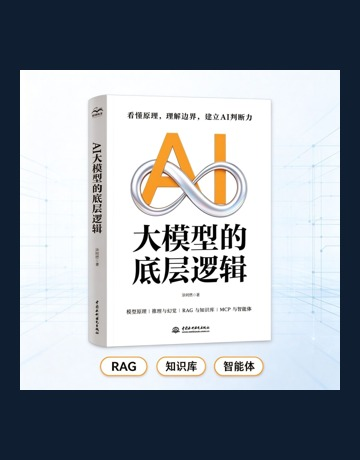
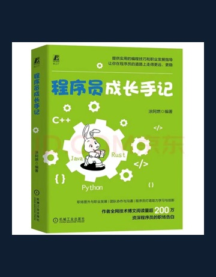
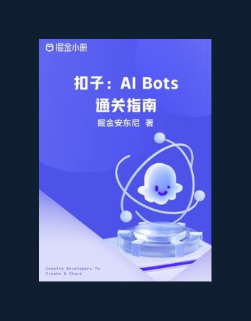
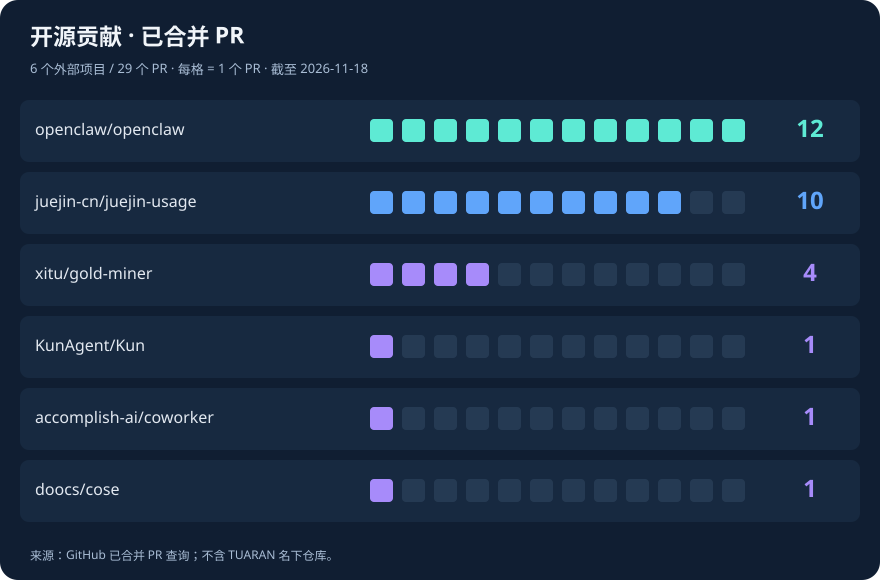

[English](README.md) · **中文**

# 涂阿燃 · TUARAN

AI 前沿部署工程师、技术作者、矩联科技创始人。研究 AI Agent、模型工具协议与上下文工程，也把这些能力接进真实产品：从原型、部署、鉴权到测试和维护。

[个人网站](https://2aran.com) · [关于我](https://2aran.com/about) · [出版作品](https://2aran.com/publications) · [邮件联系](mailto:tuaran666@gmail.com)

## 一些数字

数据明细（沿用个人简介口径，非实时统计）

| | |
| :--- | :--- |
| **1500+** | 公开内容 / 发帖 |
| **百万+ / 月** | 内容曝光量 |
| **4** | 已出版 / 发布作品 |
| **12** | 合并至 OpenClaw 主分支的 PR |

## 我在做什么

- **AI 工程**：研究和交付 AI Agent、模型集成、工具协议与上下文工程相关产品。
- **技术写作**：把前端工程化、大模型与智能体实践写成文章、图书和社区分享。
- **产品与社区**：围绕 AI 开发者生态、创作者协作与技术服务建设[矩联科技](https://matrixlink.tech)和[博主联盟](https://blogger-alliance.cn/)。

## 出版作品

<table>
<tr>
<td align="center" width="25%"> <a href="https://2aran.com/books/seedance-guide">Seedance</a></td>
<td align="center" width="25%"> <a href="https://2aran.com/books/llm-underlying-logic">AI大模型的底层逻辑</a></td>
<td align="center" width="25%"> <a href="https://2aran.com/books/programmer-growth-notes">程序员成长手记</a></td>
<td align="center" width="25%"> <a href="https://2aran.com/books/ai-bots-guide">AI Bots 通关指南</a></td>
</tr>
</table>

| 作品 | 时间 | 类型 |
| :--- | :---: | :--- |
| [《Seedance：电影级AI视频创作指南》](https://2aran.com/books/seedance-guide)（与李谊林联合编著） | 2026 | 技术图书 |
| [《AI大模型的底层逻辑》](https://2aran.com/books/llm-underlying-logic) | 2026 | 技术图书 |
| [《程序员成长手记》](https://2aran.com/books/programmer-growth-notes) | 2023 | 技术图书 |
| [《AI Bots 通关指南》](https://2aran.com/books/ai-bots-guide) | 2024 | 电子小册 |

## 开源贡献

截至 **2026-11-18**，在 **6 个外部开源项目**中有 **29 个 PR** 被合并。每个亮色方格代表一个已合并 PR；不含本人名下仓库。

| 项目 | 已合并 | PR 记录 |
| :--- | ---: | :--- |
| [openclaw/openclaw](https://github.com/openclaw/openclaw) | [12](https://github.com/openclaw/openclaw/pulls?q=is%3Apr+author%3ATUARAN+is%3Amerged) | [#179000](https://github.com/openclaw/openclaw/pull/179000) · [#170527](https://github.com/openclaw/openclaw/pull/170527) · [#169537](https://github.com/openclaw/openclaw/pull/169537) · [#167581](https://github.com/openclaw/openclaw/pull/167581) · [#164357](https://github.com/openclaw/openclaw/pull/164357) · [#148022](https://github.com/openclaw/openclaw/pull/148022) · [#120104](https://github.com/openclaw/openclaw/pull/120104) · [#113200](https://github.com/openclaw/openclaw/pull/113200) · [#102537](https://github.com/openclaw/openclaw/pull/102537) · [#98320](https://github.com/openclaw/openclaw/pull/98320) · [#91553](https://github.com/openclaw/openclaw/pull/91553) · [#90517](https://github.com/openclaw/openclaw/pull/90517) |
| [juejin-cn/juejin-usage](https://github.com/juejin-cn/juejin-usage) | [10](https://github.com/juejin-cn/juejin-usage/pulls?q=is%3Apr+author%3ATUARAN+is%3Amerged) | [#294](https://github.com/juejin-cn/juejin-usage/pull/294) · [#286](https://github.com/juejin-cn/juejin-usage/pull/286) · [#275](https://github.com/juejin-cn/juejin-usage/pull/275) · [#270](https://github.com/juejin-cn/juejin-usage/pull/270) · [#264](https://github.com/juejin-cn/juejin-usage/pull/264) · [#251](https://github.com/juejin-cn/juejin-usage/pull/251) · [#239](https://github.com/juejin-cn/juejin-usage/pull/239) · [#222](https://github.com/juejin-cn/juejin-usage/pull/222) · [#204](https://github.com/juejin-cn/juejin-usage/pull/204) · [#112](https://github.com/juejin-cn/juejin-usage/pull/112) |
| [xitu/gold-miner](https://github.com/xitu/gold-miner) | [4](https://github.com/xitu/gold-miner/pulls?q=is%3Apr+author%3ATUARAN+is%3Amerged) | [#5875](https://github.com/xitu/gold-miner/pull/5875) · [#5309](https://github.com/xitu/gold-miner/pull/5309) · [#5230](https://github.com/xitu/gold-miner/pull/5230) · [#5191](https://github.com/xitu/gold-miner/pull/5191) |
| [KunAgent/Kun](https://github.com/KunAgent/Kun) | [1](https://github.com/KunAgent/Kun/pulls?q=is%3Apr+author%3ATUARAN+is%3Amerged) | [#73](https://github.com/KunAgent/Kun/pull/73) |
| [accomplish-ai/coworker](https://github.com/accomplish-ai/coworker) | [1](https://github.com/accomplish-ai/coworker/pulls?q=is%3Apr+author%3ATUARAN+is%3Amerged) | [#855](https://github.com/accomplish-ai/coworker/pull/855) |
| [doocs/cose](https://github.com/doocs/cose) | [1](https://github.com/doocs/cose/pulls?q=is%3Apr+author%3ATUARAN+is%3Amerged) | [#242](https://github.com/doocs/cose/pull/242) |

[查询来源](https://github.com/search?q=is%3Apr+is%3Amerged+author%3ATUARAN+-user%3ATUARAN&type=pullrequests) · [数据快照](assets/merged-contributions.json)。以上为核验日期的快照，非实时统计。

## 网站与项目

| 内容与创作 | 产品与工具 |
| :--- | :--- |
| **[🧭 2aran.com](https://2aran.com)** 文章 · 调研 · 作品 | **[📰 前端周看](https://weekly.2aran.com/)** 前端与 AI 工程周刊 |
| **[✍️ SyncBlog](https://syncblog.2aran.com/)** Markdown 与多平台发布 | **[📊 从夯到拉](https://rank.2aran.com/)** AI 产品分级与比较 |
| **[🧰 Toolbox](https://2aran.com/tools)** 开发者工具 | **[🔌 Agent Resources](https://2aran.com/skill-center)** [Skill](https://2aran.com/skill-center) · [MCP](https://2aran.com/mcp-center) |

## GitHub 活动

公开 GitHub 活动由 [Activity Graph](https://github.com/Ashutosh00710/github-readme-activity-graph) 动态生成；图片不可用时可点击查看 GitHub 记录。

## 联系我

[GitHub](https://github.com/TUARAN) · [LinkedIn](https://www.linkedin.com/in/%E6%B6%82%E9%98%BF%E7%87%83-tuaran-473841210/) · [掘金](https://juejin.cn/user/1521379823340792) · [小红书](https://www.xiaohongshu.com/user/profile/68b313f9000000001901d07e) · [CSDN](https://blog.csdn.net/aifs2025) · [51CTO](https://blog.51cto.com/u_15298598) · [邮箱](mailto:tuaran666@gmail.com)

Intro animation: [readme-typing-svg](https://github.com/DenverCoder1/readme-typing-svg) · [MIT license](assets/typing-svg-LICENSE.txt). Book covers: [2aran.com](https://2aran.com/publications).
